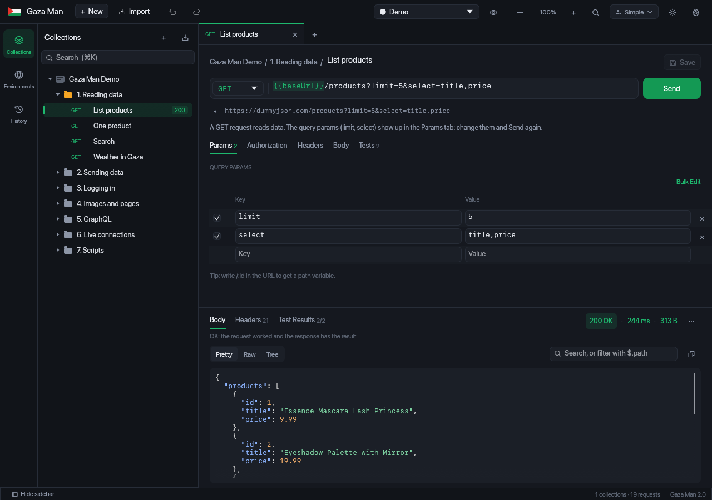
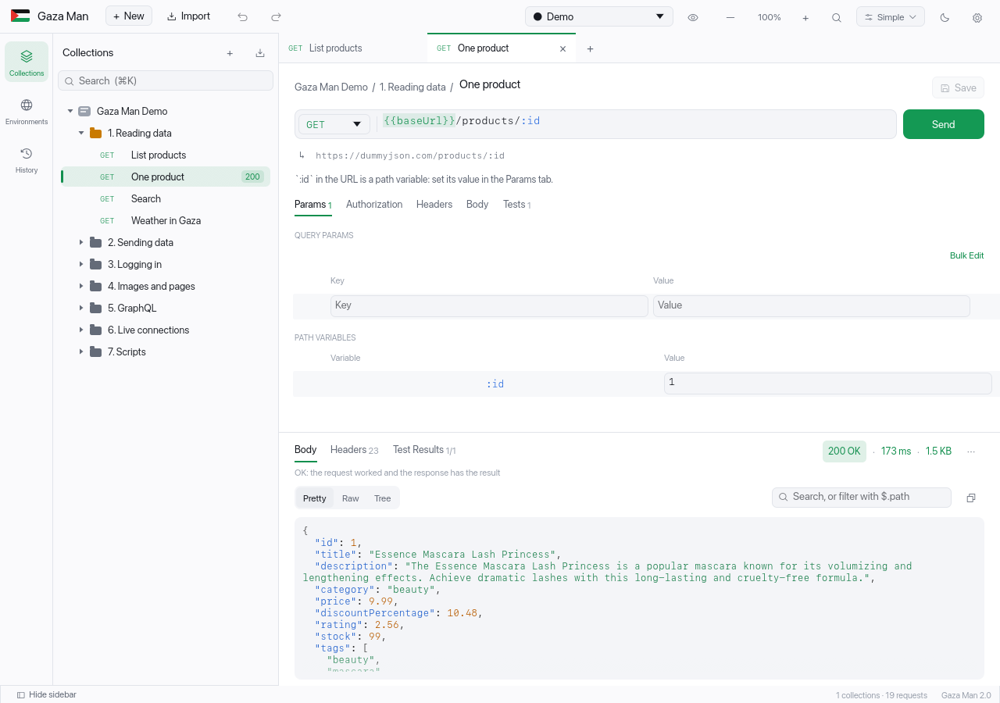
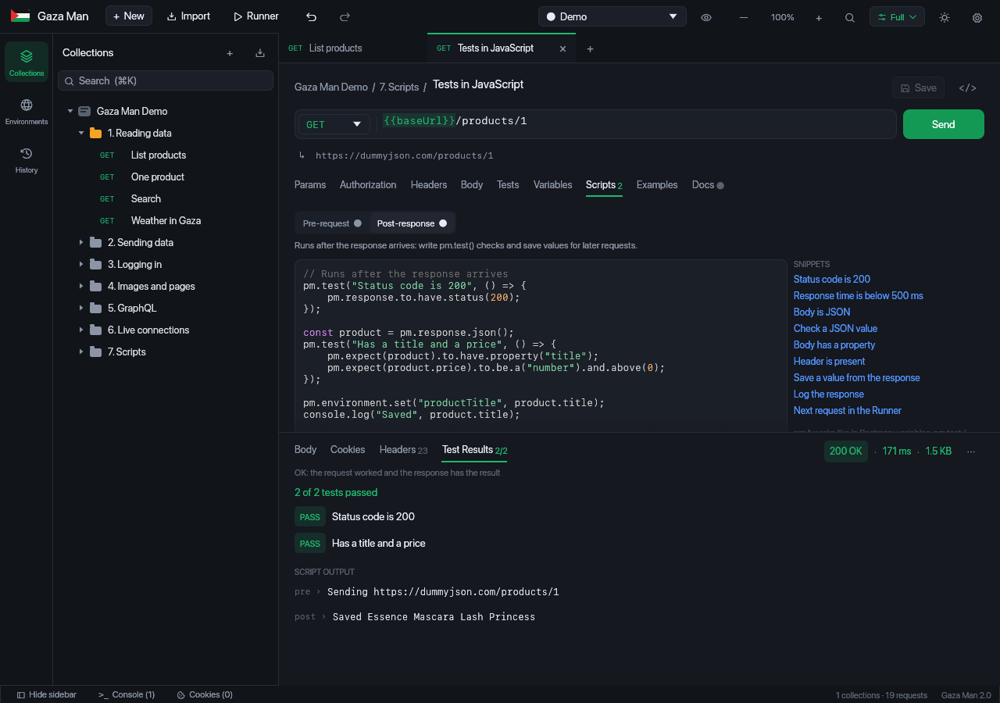
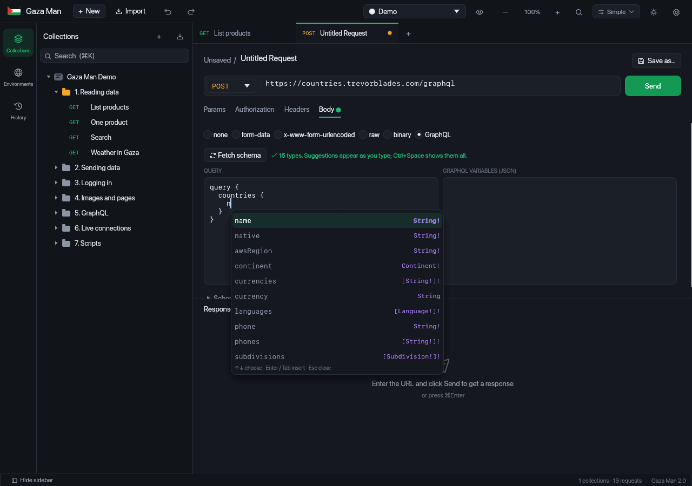
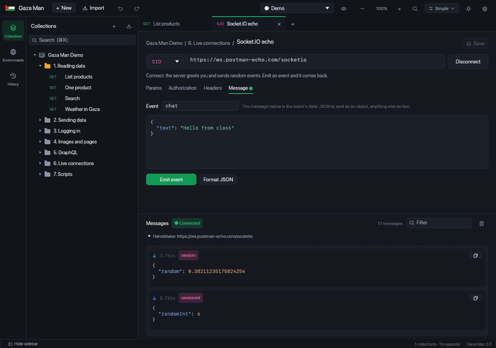
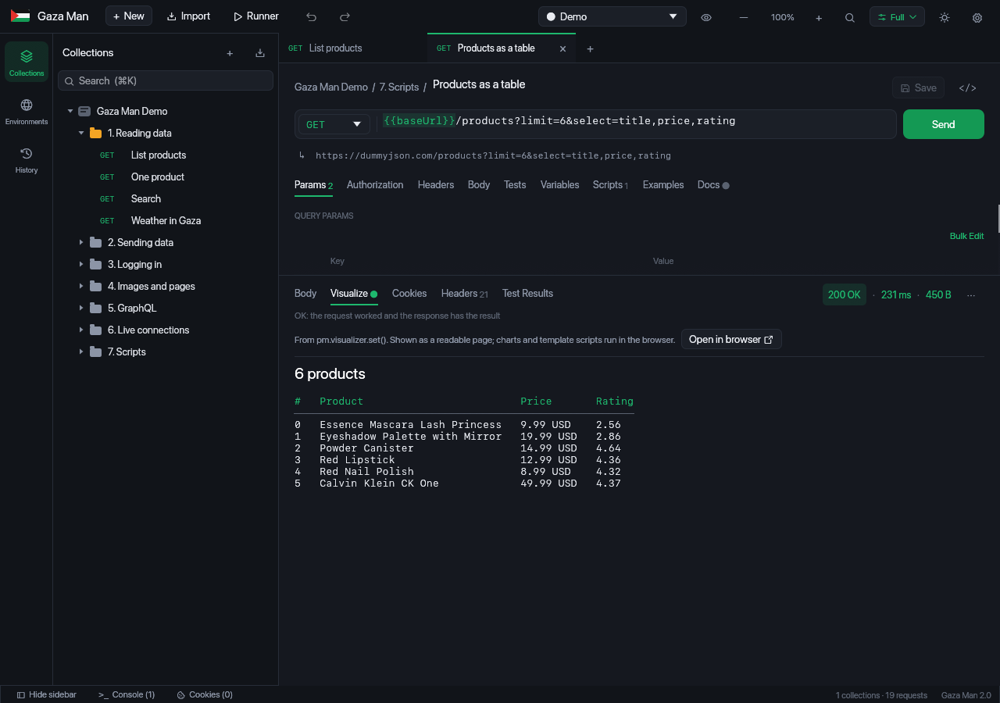
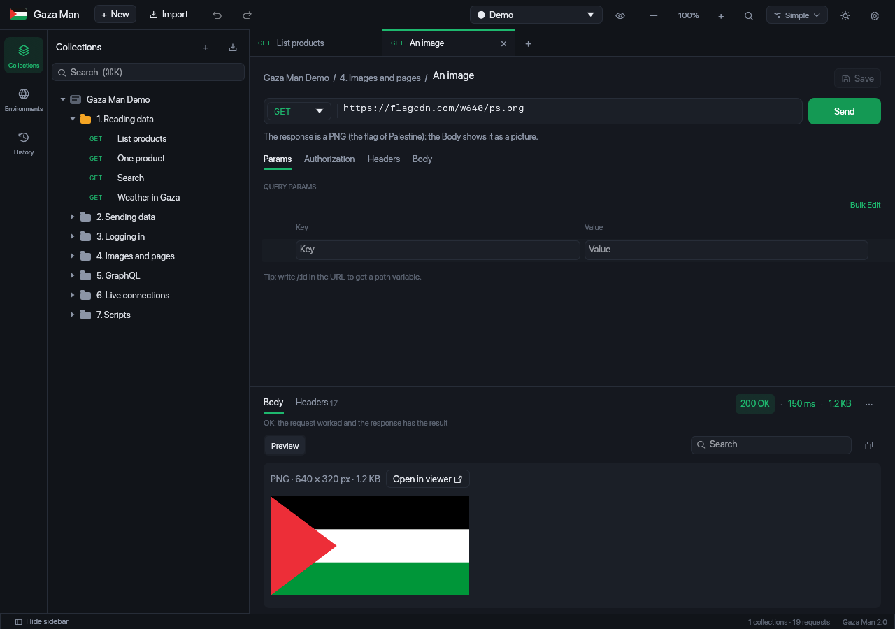
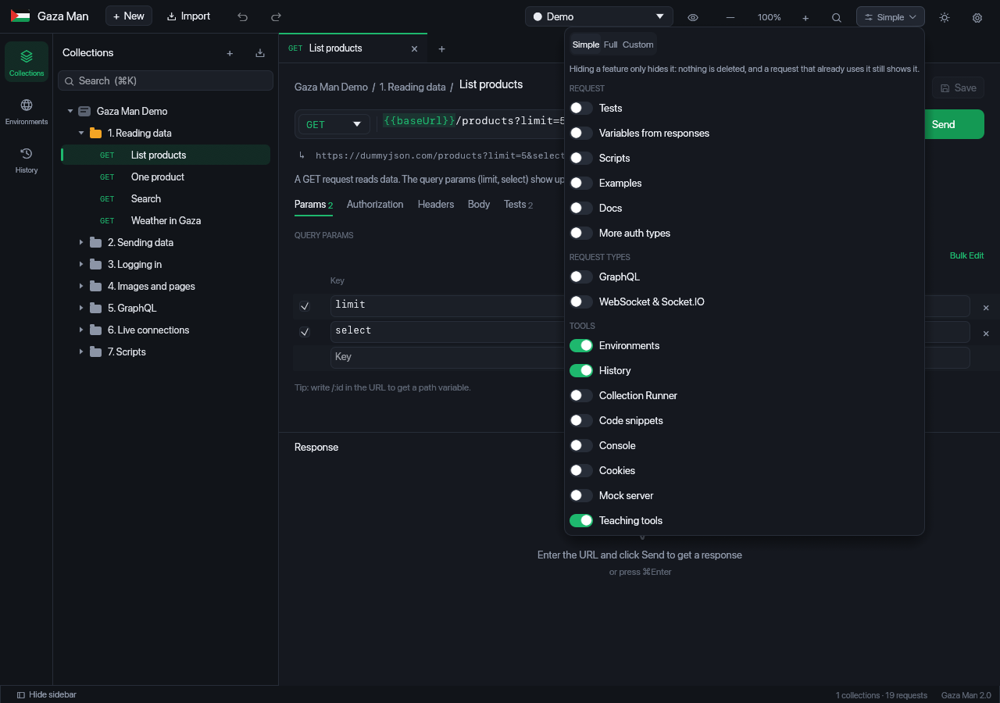
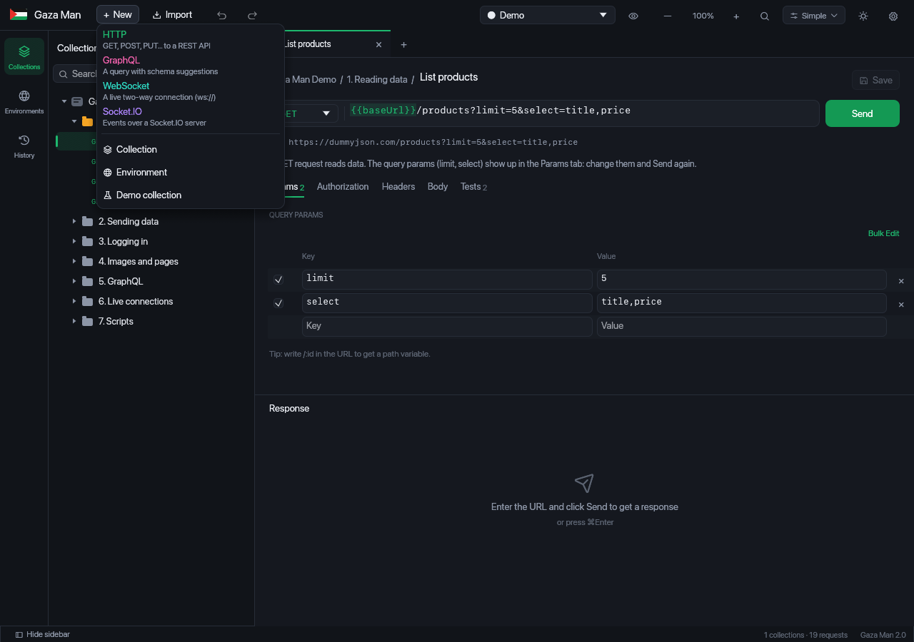
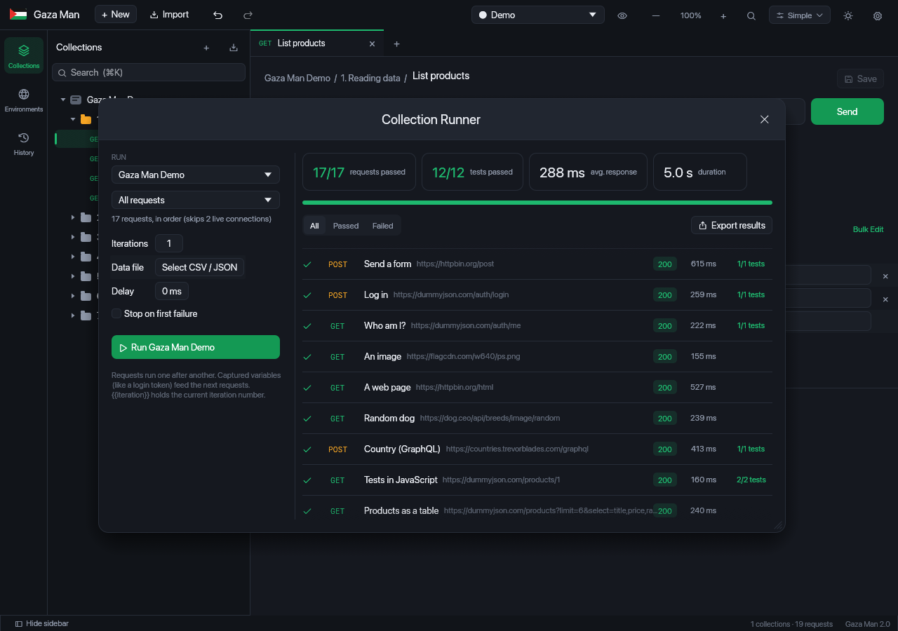

<p align="center"></p>

<h1 align="center">Gaza Man 🇵🇸</h1>

<p align="center">
A simple, fast desktop API client, written entirely in Rust.<br>
Collections, environments, tests, JavaScript scripts, GraphQL, WebSocket and Socket.IO, in one small native app.
</p>

<p align="center">
<a href="https://github.com/sabahya3/gaza-man/releases/latest/download/Gaza-Man-Setup-windows-x86_64.exe"></a>
<a href="https://github.com/sabahya3/gaza-man/releases/latest/download/Gaza-Man-macos-universal.zip"></a>
<a href="https://github.com/sabahya3/gaza-man/releases/latest/download/Gaza-Man-linux-x86_64.tar.gz"></a>
</p>

<p align="center">
<a href="https://github.com/sabahya3/gaza-man/releases/latest"></a>
<a href="LICENSE"></a>

</p>

<p align="center"><b>English</b> · <a href="README.ar.md">العربية</a></p>

<p align="center"></p>

A desktop app for trying out APIs, written entirely in Rust (with [egui / eframe](https://github.com/emilk/egui)).
Build collections, send requests, write tests and scripts, and export any request as code in 17 languages. A **Simple** mode keeps things easy for beginners and students.

## Download

From the [**Releases**](../../releases/latest) page:

| System | File | How to run |
|---|---|---|
| **Windows** 10 / 11 | [`Gaza-Man-Setup-windows-x86_64.exe`](https://github.com/sabahya3/gaza-man/releases/latest/download/Gaza-Man-Setup-windows-x86_64.exe) | Installer: open it and click Next. It adds a Start menu entry and uninstalls from Settings like any app. No admin rights needed |
| **Windows** portable | [`Gaza-Man-windows-x86_64.exe`](https://github.com/sabahya3/gaza-man/releases/latest/download/Gaza-Man-windows-x86_64.exe) | A single file you run directly, nothing to install |
| **macOS** 11+ (Apple Silicon and Intel) | [`Gaza-Man-macos-universal.zip`](https://github.com/sabahya3/gaza-man/releases/latest/download/Gaza-Man-macos-universal.zip) | Unzip and move **Gaza Man.app** to Applications. The first time, right-click it → **Open**, because the app isn't signed by Apple |
| **Linux** (x86_64) | [`Gaza-Man-linux-x86_64.tar.gz`](https://github.com/sabahya3/gaza-man/releases/latest/download/Gaza-Man-linux-x86_64.tar.gz) | Extract and run `./gaza-man`. Needs GTK 3 (included in most distributions) |

If Windows shows a SmartScreen warning, click **More info** → **Run anyway**. The app is new and unsigned.

## Screenshots

| | |
|---|---|
|  **Light theme** |  **JavaScript scripts and tests** |
|  **GraphQL suggestions from the schema** |  **A live Socket.IO connection** |
|  **pm.visualizer: the response as a table** |  **Image preview in the response** |
|  **Choose what is shown** |  **HTTP, GraphQL, WebSocket and Socket.IO** |
|  **Run a whole collection (Runner)** | |

## Build from source

You need [Rust](https://rustup.rs) 1.85 or newer:

```bash
cargo run --release
```

Or open a file directly (a v2 / v2.1 collection, OpenAPI, Insomnia or HAR):

```bash
cargo run --release -- my-api.collection.json
```

On Linux, install these libraries first:

```bash
sudo apt install libgtk-3-dev libxkbcommon-dev libxcb-render0-dev libxcb-shape0-dev libxcb-xfixes0-dev libwayland-dev pkg-config
```

### A double-clickable Mac app

```bash
./make-app.sh            # for this Mac
./make-app.sh universal  # for every Mac (Apple Silicon and Intel)
```

This creates `Gaza Man.app` in the project folder. You can move it to Applications.

### A new release

Push a version tag, and GitHub Actions builds the Windows, Linux and macOS versions and puts them on Releases:

```bash
git tag v2.0.0 && git push origin v2.0.0
```

## Simple or Full: you choose

The **Simple** button at the top right changes how much of the app you see:
- **Simple** (the default): only the essentials. The URL, Params, Authorization, Headers, Body, the response, **Environments** and History.
- The eye button 👁 next to the environment shows every variable at once: collection variables (like `{{baseUrl}}`), environment variables and globals, each with a button to edit them. It stays visible even when Environments are turned off.
- **Full**: every feature.
- **Custom**: from the same button, turn each feature on or off on its own: Tests, Scripts, Environments, Runner, Console, Cookies, Mock server, GraphQL, WebSocket and the teaching tools.

Turning a feature off only hides it; nothing is deleted. If a request already uses it (has a script, for example), its tab stays visible in that request.

## New request

The **+ New** button lists every type: **HTTP**, **GraphQL**, **WebSocket** and **Socket.IO**, each with a line about what it does. If you pick a type that's off in your current mode, the app turns it on for you. There's also **Demo collection**, which brings the demo back at any time.

## The demo

The **Gaza Man Demo** collection uses real, public APIs and is numbered like a lesson:
1. **Reading data**: GET, query params and path variables on dummyjson.com, and the weather in Gaza from Open-Meteo.
2. **Sending data**: POST, PUT, PATCH, DELETE and form-data.
3. **Logging in**: a login that saves the token, and a next request that uses it as a Bearer token.
4. **Images and pages**: a response with an image, and an HTML page.
5. **GraphQL**: data about Palestine from the Countries API.
6. **Live connections**: WebSocket and Socket.IO on public echo servers.
7. **Scripts**: pre-request and post-response JavaScript.

Each request has a note explaining what it teaches. The Runner runs the whole collection and skips WebSocket and Socket.IO, since those are connections that stay open.

## Features

### Collections
- **Collections and nested folders** in a sidebar tree: add, rename, duplicate, delete, reorder (Move up/down) and **drag and drop** between folders and collections.
- **Search** across all requests by name, URL or method (⌘K).
- **Collection and folder settings**: a description, an Authorization that everything inside inherits, and collection variables.
- **Tabs** like a browser: each request in its own tab, an orange dot for unsaved changes, and **Save / Save as** (⌘S).

### Requests
- **Params**: a Query Params table kept in sync with the URL, and **Path Variables** (write `/:id` in the URL).
- **Authorization**: Inherit / No Auth / Bearer / Basic / API Key (header or query) / **Digest** / **AWS Signature v4** / **NTLM** / **OAuth 2.0** (with a button that gets an access token using Client Credentials or Password).
- **Headers**, including a view of the headers added automatically.
- **Body**: none / form-data (text **and files**) / x-www-form-urlencoded / raw (JSON, Text, JavaScript, HTML, XML) with highlighting, JSON validation and Beautify / binary / **GraphQL**.
- **Bulk Edit** for any key:value table.
- **Variables** `{{name}}` turn green when defined and red when not, with **suggestions** as you type `{{`, and the final URL shown under the field.
- **Dynamic variables**: `{{$guid}}` `{{$timestamp}}` `{{$isoTimestamp}}` `{{$randomInt}}` `{{$randomEmail}}` `{{$randomFullName}}` and more.
- **Paste a cURL command** into the URL field and it becomes a full request.
- **Examples**: save any response as an example inside the request. It shows up in exported docs, and the mock server answers with it.
- **Undo / Redo** (⌘Z / ⌘⇧Z) for anything deleted or changed by mistake.

### GraphQL
- **Fetch schema** asks the server for its schema (introspection), using the same URL, headers and auth.
- **Suggestions as you type**, based on where you are in the query: inside `countries { }` it suggests only the fields of `Country`, with each field's type and description. Enter or Tab picks one, the arrows move, and Ctrl+Space shows every suggestion. Fields that have fields of their own are inserted with `{ }` and the cursor inside.
- **Schema explorer**: a tree of every Query and Mutation and their fields. Click a field to add it to the query.
- Indentation is handled automatically when you press Enter.

### WebSocket and Socket.IO
- Pick **WebSocket** or **Socket.IO** from the method list next to the URL, then press **Connect**.
- `ws://` and `wss://` (with SSL). Headers and auth are sent in the handshake.
- **Socket.IO** v2, v3 and v4: the server's version is detected automatically (or add `EIO=3` to the URL to force v2). It joins the namespace (put it at the end of the URL, like `/chat`), answers pings by itself, and lets you write the **event** name and data (JSON is sent as an object, anything else as text).
- **Message log**: what you sent (green ↑) and what you received (blue ↓) with times, the event name, formatted and highlighted JSON, search, copy, and the handshake headers.

### Tests and variables (no code)
- **Tests**: status code / response time / JSON path / header / body, with equals, greater than, contains, exists… and PASS / FAIL next to each test.
- **Variables (Capture)**: save part of the response into a variable (like a token after logging in) in the environment, the collection or globals, for the next requests to use.
- When you export a collection, these tests become **real `pm.test()` scripts** that run in any tool supporting that format.

### Responses
- **Pretty / Raw / Tree** for JSON, search that highlights matches, and filtering with `$.path`.
- In the **Tree**, right-click any value → Copy, **"Test: equals"** or **"Save to variable"**.
- Headers, **Cookies**, **Test Results**, size and time, and **an explanation for every status code** (useful when teaching).
- **Preview**: images (PNG, JPEG, GIF, WebP, BMP, ICO and **SVG**) are shown as images, and HTML as a **reader view** (headings, paragraphs, lists and links without the styling), with an **Open in browser** button for the real page.
- Save the response to a file.

### Code
- The `</>` button shows the request as code in **17 languages**: cURL, JavaScript Fetch, Axios, Python Requests, Go, PHP cURL, Java HttpClient, C# HttpClient, Swift, Kotlin OkHttp, Dart, Ruby, Rust reqwest, PowerShell, HTTPie, wget and raw HTTP. Copy it or save it to a file.

### Environments and globals
- Several environments (like Local and Production), switched from the top bar, plus the 👁 button for a quick look at the variables.
- Precedence: Globals ← Collection ← Environment.

### Collection Runner
- Runs a collection or folder in order, with **Iterations**, **Delay** and **Stop on first failure**.
- **Data file (CSV or JSON)**: each row is one iteration, and its columns are variables you can use in the requests.
- A summary (requests passed, tests passed, average time, duration), a Passed / Failed filter, the details of each test, and **export of the results** as JSON.
- Variables saved by one request reach the next one, and `{{iteration}}` holds the iteration number.

### Import / Export
- **Import**: v2 / v2.1 collections, environments and globals, **OpenAPI 3 / Swagger 2** (JSON or **YAML**, with body examples generated from the schema), **Insomnia**, **HAR** (exported from the browser's Network tab; recorded responses become examples) and **cURL commands**. Use the Import button or drop files on the window.
- **Collection export**: Collection v2.1, **OpenAPI 3**, a good-looking **HTML documentation page**, Markdown, a cURL script and an `.http` file.
- Environment export in the common JSON format.

### Other things
- **History** of every request sent, grouped by day.
- **Cookie jar**: cookies are saved and sent back automatically like a browser, with a cookie manager to delete them.
- **Console** (⌘⌥C) shows each request exactly as it was sent, and its response.
- **Local mock server**: from the collection page, it answers on `localhost` with the saved examples. Useful for students when the API isn't built yet.
- **Settings**: timeout, follow redirects, SSL verification, **proxy**, **client certificates (mTLS)** and a custom CA certificate, cookies, User-Agent, history size.
  These settings apply to WebSocket and Socket.IO too: HTTP, SOCKS4 or SOCKS5 proxies (with username and password), client certificates and the CA.
- **Dark and light themes**.
- Everything is saved automatically, and collections from the older version are still there.

## Teaching tools

- **The lens 🔍** (button at the top, or ⌘/Ctrl + L): magnifies any part of the app under the mouse.
  - ⌥ Option + scroll: zoom the lens in and out (1.25× to 8×), or `[` and `]`
  - ⌥ Option + ⇧ Shift + scroll: make the lens itself bigger or smaller
  - Esc: close the lens
- **Zoom the whole app**: the − / 100% / + buttons at the top, or ⌘/Ctrl +, ⌘/Ctrl − and ⌘/Ctrl 0.
- The **Gaza Man Demo** collection appears on first launch, with examples of everything (variables, path params, tests, capture, form-data, GraphQL).

## Keyboard shortcuts

| Shortcut | Action |
|---|---|
| ⌘ Enter | Send |
| ⌘ S | Save |
| ⌘ T | New request |
| ⌘ W | Close tab |
| ⌘ ⇧ ] / [ | Next / previous tab |
| ⌘ O | Import |
| ⌘ K | Search |
| ⌘ B | Show / hide the sidebar |
| ⌘ ⇧ R | Collection Runner |
| ⌘ ⌥ C | Console |
| ⌘ , | Settings |
| ⌘ L | Lens |
| ⌘ Z / ⌘ ⇧ Z | Undo / Redo |
| Ctrl Space | All GraphQL suggestions |

On Windows and Linux, use Ctrl in place of ⌘ and Alt in place of ⌥.

## Project files

| File | What it does |
|---|---|
| `src/main.rs` | Opens the window |
| `src/app.rs` | App state (collections and tabs), commands, sending requests, and the Runner |
| `src/ui_sidebar.rs` | The top bar and sidebar (Collections, Environments, History), tabs and status bar |
| `src/ui_request.rs` | The request editor, the response, and the code panel |
| `src/ui_dialogs.rs` | Collection and environment pages, and the windows (Import, Save, Runner, Settings, Cookies, Console) |
| `src/collection.rs` | The data model, and reading and writing the v2 / v2.1 collection format |
| `src/http.rs` | Variables, auth, bodies, sending, and cookies |
| `src/tests.rs` | Tests and captures, and turning them into `pm.test` scripts |
| `src/codegen.rs` | Code generation in 17 languages |
| `src/import.rs` | Importing collections, cURL, OpenAPI, Insomnia and HAR |
| `src/yaml.rs` | A small YAML reader for OpenAPI files |
| `src/graphql.rs` | The schema, and suggestions based on the cursor position |
| `src/ws.rs` | The WebSocket and Socket.IO client |
| `src/preview.rs` | Image and HTML preview |
| `src/mock.rs` | The local mock server |
| `src/auth.rs` and `src/crypto.rs` | Digest, AWS Signature, NTLM and the cryptography they need |
| `src/data.rs` | Reading CSV and JSON data files for the Runner |
| `src/script.rs` | Running scripts with the QuickJS engine |
| `src/pm.js` | The `pm.*` API itself, written in JavaScript |
| `src/pm_libs.js` | moment, cheerio, xml2Json and Handlebars (for the visualizer) |
| `src/export.rs` | Export to Collection v2.1, OpenAPI, HTML, Markdown, cURL and `.http` |
| `src/theme.rs` | Colors, fonts, and the app's custom widgets |
| `src/rtl.rs` | Showing Arabic text in the right order |
| `src/lens.rs` | The magnifying lens |
| `src/shot.rs` | A screenshot mode for testing the UI from a script |
| `src/features.rs` | Simple and Full modes, and showing or hiding each feature |
| `assets/fonts/Phosphor.ttf` | [Phosphor](https://phosphoricons.com) icons (MIT license, in `Phosphor-LICENSE.txt`) |
| `assets/icon.svg` | The original icon. `GazaMan.icns` and `window-icon.png` are made from it |

## Tests

```bash
cargo test
```

## A note on Arabic text

- **Displayed text** (collection and request names, responses, HTML pages) is shown in the correct order.
- **Fields you type in** (URL, params, headers, body, description):
  - **When you're not typing in them**, Arabic is shown in the correct order.
  - **While you type**, it's shown in typing order, and a **"Reads as"** line under the field shows the line with the cursor in the correct order.
- The reason: egui itself doesn't support right-to-left typing inside text fields yet.

## Scripts (JavaScript)

The **Scripts** tab on every request, folder and collection has **Pre-request** (before the request is sent) and **Post-response** (after the response arrives), with code highlighting and a list of **Snippets** you can click to insert.

They run in this order: the collection's script, then the folder's, then the request's. The engine is QuickJS, so modern JavaScript works (arrow functions, async/await, destructuring...).

**Supported API:**
- **Variables**: `pm.environment`, `pm.collectionVariables`, `pm.globals`, `pm.variables` and `pm.iterationData`, with `get`, `set`, `unset`, `has`, `toObject`, `clear` and `replaceIn`.
- **Tests**: `pm.test(name, fn)` and `pm.test.skip`, and Chai-style `pm.expect`: `to.equal`, `eql`, `deep.equal`, `include`, `have.property`, `lengthOf`, `a("array")`, `above`, `below`, `match`, `oneOf`, `ok`, `true`, `null`, `exist`, `empty`, `not`...
- **Response**: `pm.response.code`, `status`, `responseTime`, `json()`, `text()` and `headers.get()`, plus `pm.response.to.have.status(200)`, `to.be.ok`, `to.have.header()` and `to.be.json`.
- **Request**: `pm.request.url`, `method`, `headers.add / upsert / remove` and `body.raw`. Changes made in a pre-request script are really sent.
- **`pm.sendRequest`**, with a callback or with `await`, for example to fetch a token before the request.
- **`console.log`** shows up in Test Results and in the Console.
- **`CryptoJS`** (MD5, SHA1, SHA256, Hmac and Base64), `atob` / `btoa`, `require('crypto-js')` and `require('uuid')`.
- **lodash** (`_` or `require('lodash')`): the most used functions, like `get`, `set`, `pick`, `omit`, `map`, `filter`, `find`, `sortBy`, `orderBy`, `groupBy`, `countBy`, `uniq`, `isEqual`, `isEmpty`, `cloneDeep`, `merge`, `range`, `sum` and `camelCase`.
- **In the Runner**: `pm.execution.setNextRequest(name)` and `pm.execution.skipRequest()`.
- **The older syntax**: `tests["..."] = true`, `responseBody`, `responseCode` and the old `setEnvironmentVariable` functions.

**Safety:** every script must finish within 10 seconds (so an endless loop can't freeze the app), and can use at most 64 MB of memory.

- **`moment`**: `format`, `add`, `subtract`, `diff`, `startOf`, `endOf`, `isBefore`, `isAfter`, `utc`, `unix` and `fromNow`.
- **`cheerio`**: read HTML with CSS selectors (`#id`, `.class`, `[attr]`, `>`, `:first-child`...), with `text()`, `attr()`, `html()`, `find()`, `each()` and `map()`.
- **`xml2Json(responseBody)`**: turns XML into an object (attributes go in `$`).
- **`pm.visualizer.set(template, data)`**: a Handlebars template (`{{x}}`, `{{#each}}`, `{{#if}}`), shown in the response's **Visualize** tab. Tables are shown as aligned columns, and **Open in browser** opens the real page, which includes `pm.getData` so the template's scripts work.
- **`pm.vault`**: secrets like API keys and passwords, stored only on your computer and never exported with a collection. Edit them in **Settings → Vault**, and use them as `{{vault:name}}` or `await pm.vault.get("name")`.
- **`pm.cookies.jar()`**: `get`, `getAll`, `set`, `unset` and `clear` on the app's real cookies.

If `pm.environment.set` is called with no active environment, the value is saved in globals.

## License

[MIT](LICENSE): you can use, change and share the code, as long as the copyright notice stays.

Icons from [Phosphor](https://phosphoricons.com) (MIT license, in [`assets/fonts/Phosphor-LICENSE.txt`](assets/fonts/Phosphor-LICENSE.txt)).
